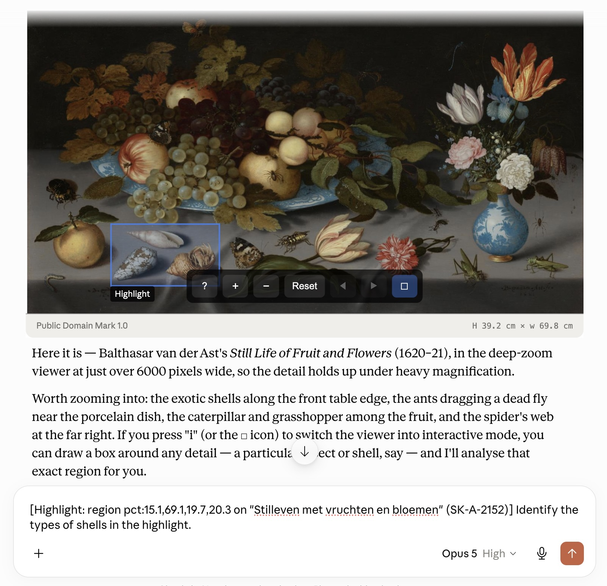

# rijksmuseum-mcp+

[](https://modelcontextprotocol.io/specification/2026-07-28)
[](https://www.npmjs.com/package/@modelcontextprotocol/server)
[](https://github.com/modelcontextprotocol/ext-apps)

## Overview

The **rijksmuseum-mcp+** MCP server lets you explore the Rijksmuseum's artwork collections through natural conversation with an AI assistant. It does this by creating a [bridge](https://www.anthropic.com/news/model-context-protocol) between the AI system's chat environment and an enriched copy of the museum's [open-access, curated metadata](https://data.rijksmuseum.nl). This in turn enables [many features beyond those offered by the Rijksmuseum](/docs/compared-to-rijksmuseum.md) through their [Search API](https://data.rijksmuseum.nl) and [collections portal](https://www.rijksmuseum.nl/en/collection/). Rijksmuseum-mcp+ works best when used together with [rijksmuseum-iconclass-mcp](https://github.com/kintopp/rijksmuseum-iconclass-mcp), a sibling resource for searching and exploring [Iconclass](https://iconclass.org) concepts.

> Please do not treat the data made available by this resource as current or authoritative. It is based on data copied from the Rijksmuseum on May 2nd, 2026. For current data, please always use the Rijksmuseum's own [search portal](https://www.rijksmuseum.nl/en/collection/) and [APIs](https://data.rijksmuseum.nl). Nor have the (in small part, LLM based) enrichments of the museum's provenance data been reviewed or endorsed by the Rijksmuseum. This is a technology demo that remains – by its nature – in active development.

This MCP server was developed by the [Research and Infrastructure Support](https://rise.unibas.ch/en/) (RISE) group at the University of Basel. We are particularly interested in exploring the research opportunities, methodological risks, and technical challenges posed by retrieving and analysing data with LLMs. If you are interested in collaborating with us in this area, please [get in touch](mailto:rise@unibas.ch).

## Key Features

- **Searching artwork metadata**. You can search artworks by keyword, by structured filters (artist, type, material, technique, date, physical dimensions, production place), or by meaning — a semantic search that handles interpretive queries like "melancholy winter scenes at dusk". There's also [iconographic search via Iconclass codes](https://kintopp.github.io/rijksmuseum-mcp-plus/iconclass-visualization), so you can ask for works depicting a specific scene or motif rather than just matching words in titles.
- ✨ **Searching digitised artworks visually**. A multimodal search can match a plain-language description such as "children playing in the street" against the digitised images themselves, not only against catalogue metadata. Each result then notes whether it was found through the image, the catalogue text or the Iconclass codes. The search can be further narrowed with filters, for example to paintings, a period, or a single artist.
- **Interactive, inline viewer**. You can view images from the collections in your chat session. You can also instruct the AI-assistant to inspect image regions for you — this is useful for analysing a specific area of the image you've highlighted for it in the interactive viewer. If an artwork has curator defined related artworks (e.g. preparatory sketches, or different impressions of the same design) these can be accessed directly through the viewer — its < / > buttons step through them in place, without leaving the viewer.
  <p align="center"></p>
- **Collection-level analysis**. You can ask for statistical breakdowns across the whole collection: top creators, distributions by decade, type, or theme, geographic spread, as well as demographic questions.
- **Provenance and ownership history**. Trace who owned a work and when, which works passed through a particular collector or dealer, sales and confiscations in a given city or period, price histories, and how long families held their collections. This is made possible by an [experimental AAM parser](https://kintopp.github.io/rijksmuseum-mcp-plus/provenance-parser-visualization.html) that permits structured, [CMOA/PLOD-aligned queries](https://kintopp.github.io/rijksmuseum-mcp-plus/provenance-patterns.html).
- **Scholarly apparatus**. Lookup bibliographies for individual works, reverse lookups (which artworks cite a given publication), and conservation histories including technical examinations such as X-rays, infrared, and dendrochronology.
- **Relationships between works**. A similarity engine ("find images similar to..") [compares works across multiple dimensions](https://kintopp.github.io/rijksmuseum-mcp-plus/similar-to-SK-A-1115.html) — visual, thematic, lineage, shared subject — and surfaces pendants, pairs, copies, reproductive prints after paintings, and different impressions of one design.
- **People and places**. You can search persons by profession, lifespan, or birthplace and then view their works, or run geospatial queries (e.g. "works depicting places within 20 km of Haarlem").
- **Linked Open Data**. Works carry persistent handle.net URIs and other external IDs, and entities (creators, materials, depicted persons and places, themes) carry identifiers linking them to Wikidata, VIAF, ULAN, and RKD.
- **Command-line interface.** The [bundled `rijks-mcp` tool](https://github.com/kintopp/rijksmuseum-mcp-plus/blob/main/docs/technical-guide.md#cli) runs the same queries from the terminal — each tool exposed as a verb, with JSONL output for piping into tools such as `jq` so that results are scriptable and reproducible.

## Research Scenarios

The system is designed to let you search, explore and ask questions about the Rijksmuseum's collections in natural language. For example:

*What is the actual distribution of Rembrandt's works in the Rijksmuseum across painting, printmaking, and drawing — and how does this challenge popular perceptions of him as primarily a painter?* [Demo](https://claude.ai/share/e2070805-94a5-4e35-9aea-24b6274b641d) 

For examples of more complex queries and sample responses, please browse the [research scenarios](docs/research-scenarios.md). Nine scenarios for art historians and curators cover iconographic, semantic and multimodal search, image inspection, similarity search, provenance, collectors' marks, bibliography and conservation records, each with a shared demo transcript.

## Installation

### Hosted

The easiest way to start is to install the Rijksmuseum MCP+ plugin. It adds the hosted version of the server as a connector (shown as "Rijksmuseum"), together with the [research skill](#research-skill) that tells the AI assistant how to use it. The server needs no account or sign-in information.

**Claude** ([claude.ai](https://claude.ai), or the Claude [desktop app](https://claude.com/download)): *// recommended*

1. Download [`rijksmuseum-claude.zip`](https://github.com/kintopp/rijksmuseum-mcp-plus/raw/refs/heads/main/plugin/rijksmuseum-claude.zip).
2. In Claude, go to _Settings_ → _Plugins_ → _Browse plugins_ (scroll down to the bottom) → _Add_ → _Upload plugin_ and choose the file.
3. Open the plugin, go to its _Connectors_ tab, and add the "Rijksmuseum" connector.
4. If you like, set the permissions for its tools in _Customize_ → _Connectors_, for example to "Always allow".

**N.B.** A free Claude account allows only one custom connector. To make room for it, you will need to remove (not just disable) any existing custom connector in _Customize_ → _Connectors_ first. Adding the Iconclass server as well (see below) requires a paid ('Pro') or higher [subscription](https://claude.com/pricing). Anthropic's [plugin instructions](https://claude.com/docs/plugins/overview#install-a-plugin) provide more details.

**ChatGPT** ([desktop app](https://chatgpt.com/download/) – not chatgpt.com):

1. Download [`rijksmuseum-chatgpt.zip`](https://github.com/kintopp/rijksmuseum-mcp-plus/raw/refs/heads/main/plugin/rijksmuseum-chatgpt.zip).
2. In the ChatGPT desktop app, go to _Settings_ → _Plugins_ → _Add_ and _Upload plugin archive_. Select and _Add_ the plugin.
3. Next select _Install plugin_. After this the plugin is available.
4. To use it, create a new chat, switch to 'Work' mode, and select the plugin via the + symbol. Else, type "@Rijksmuseum MCP+" at the start of the prompt. **N.B.** You can only use a custom plugin from the 'Work' mode in ChatGPT or in Codex.

**Other AI clients:** add the hosted server as a remote MCP server (often called a "custom connector") with this URL, and leave the authentication settings empty:

```
https://rijksmuseum-mcp-plus-production.up.railway.app/mcp
```

The free version of [Mistral's Vibe](https://chat.mistral.ai) also has excellent support for MCP servers, including components like the interactive image viewer. **N.B.** A connector added this way has no skill; install the skill file separately (see [below](#research-skill)).

### Iconclass

Afterwards, follow the same procedure to install rijksmuseum-mcp+'s sibling resource for Iconclass, [rijksmuseum-iconclass-mcp](https://github.com/kintopp/rijksmuseum-iconclass-mcp), which has its own [plugin](https://github.com/kintopp/rijksmuseum-iconclass-mcp/tree/main/plugin). This allows you to automatically search and explore c. 1.3 million [Iconclass](https://iconclass.org) notations, concepts, and descriptive texts alongside the Rijksmuseum's metadata.

### Local

Alternatively, you can install rijksmuseum-mcp+ *locally* on your own computer. Please consult the [technical guide](/docs/technical-guide.md) for more details.

## Research skill

A skill gives an AI assistant detailed guidance in natural language on how to use a resource such as an MCP server effectively: which tool to choose for a given question type, how to combine searches, important metadata distinctions (e.g. `subject` terms vs `iconclass` notations), and known limitations. The `rijksmuseum-mcp+` skill also includes reference files with a full description of the available provenance search patterns and the `find_similar` functionality. Skills were [originally developed by Anthropic](https://claude.com/resources/tutorials/teach-claude-your-way-of-working-using-skills) for their Claude products but have since become a widely-supported [open standard](https://agentskills.io/home).

The plugin (see [Installation](#installation) above) already includes the skill. You only need the Rijksmuseum skill file if you add the server as a custom connector, install it locally, or use a client without plugin support. To access the skill file, download and unzip: [`rijksmuseum-mcp-plus.zip`](https://github.com/kintopp/rijksmuseum-mcp-plus/releases/latest/download/rijksmuseum-mcp-plus.zip). If you use [Mistral Vibe](https://mistral.ai/products/vibe/), install the skill via the 'folder' option.

To add your own instructions, such as how to cite results, don't edit the installed copy. Instead, put them in a separate skill or in your project's instructions, so that an update of the plugin doesn't overwrite them.

## Technical Design

For local setup (stdio or HTTP, also via cli), deployment, architecture, data sources, and configuration, please see the [technical guide](/docs/technical-guide.md). For measurements of what the server costs and saves in tokens compared with plain web search, see the (still early and experimental) [benchmarks](/docs/benchmarks.md).

The enriched metadata is available as a standalone SQLite database ([`vocabulary.db.gz`](https://github.com/kintopp/rijksmuseum-mcp-plus/releases/download/v0.90/vocabulary.db.gz), from the [v0.90 release](https://github.com/kintopp/rijksmuseum-mcp-plus/releases/tag/v0.90)). Its tables, joins and example queries are described in the [database schema](/docs/database-schema.md).

## Roadmap

Ongoing:

- fix bugs and fine-tune queries and tool descriptions

Later:

- paper/presentation

Maybe:

- OCR/HTR of appropriate images in the collection
- incorporate historical exhibition data
- integrate with other Linked Open Data resources (e.g. [Colonial Collections](https://data.colonialcollections.nl))
- support inferred geolocation data
- improve the `description` signal for *find_similar* (e.g. via a LLM re-ranker)

## Authors

[Arno Bosse](https://orcid.org/0000-0003-3681-1289) — [RISE](https://rise.unibas.ch/), University of Basel with [Claude Code](https://claude.com/product/claude-code), Anthropic.

## Citation

If you use rijksmuseum-mcp+ in your research, please cite it as follows:

**APA (7th ed.)**

> Bosse, A. (2026). *rijksmuseum-mcp+* (Version 0.96) [Software]. Research and Infrastructure Support (RISE), University of Basel. https://github.com/kintopp/rijksmuseum-mcp-plus

**BibTeX**
```bibtex
@software{bosse_2026_rijksmuseum_mcp_plus,
  author    = {Bosse, Arno},
  title     = {{rijksmuseum-mcp+}},
  year      = {2026},
  version   = {0.96},
  publisher = {Research and Infrastructure Support (RISE), University of Basel},
  url       = {https://github.com/kintopp/rijksmuseum-mcp-plus},
  orcid     = {0000-0003-3681-1289},
  note      = {Developed with Claude Code (Anthropic, \url{https://www.anthropic.com})}
}
```

## Image and Data Credits

Collection data and images are provided by the **[Rijksmuseum, Amsterdam](https://www.rijksmuseum.nl/)** via their [Linked Open Data APIs](https://data.rijksmuseum.nl/).

**Licensing:** Information and data that are no longer (or never were) protected by copyright carry the **Public Domain Mark** and/or **[CC0 1.0](https://creativecommons.org/publicdomain/zero/1.0/)**. Where the Rijksmuseum holds copyright, it generally waives its rights under CC0 1.0; in cases where it does exercise copyright, materials are made available under **[CC BY 4.0](https://creativecommons.org/licenses/by/4.0/)**. Materials under third-party copyright without express permission are not made available as open data. Individual licence designations appear on the [collection website](https://www.rijksmuseum.nl/en/rijksstudio).

**Attribution:** The Rijksmuseum considers it good practice to provide attribution and/or source citation via a credit line and data citation, regardless of the licence applied. Please see the Rijksmuseum's [information and data policy](https://data.rijksmuseum.nl/policy/information-and-data-policy) for the full terms.

**Enriched data:** The enrichments this project adds to the vocabulary database, such as the parsed provenance tables, and the embeddings database (`gemma.db`) are released under **[CC0 1.0](https://creativecommons.org/publicdomain/zero/1.0/)**. The Rijksmuseum records they are built on keep the licences described above.

> This project was inspired by [@r-huijts/rijksmuseum-mcp](https://github.com/r-huijts/rijksmuseum-mcp), the original Rijksmuseum MCP server based on the museum's now superseded REST API.

## License

The software in this project is licensed under the [MIT License](LICENSE).
