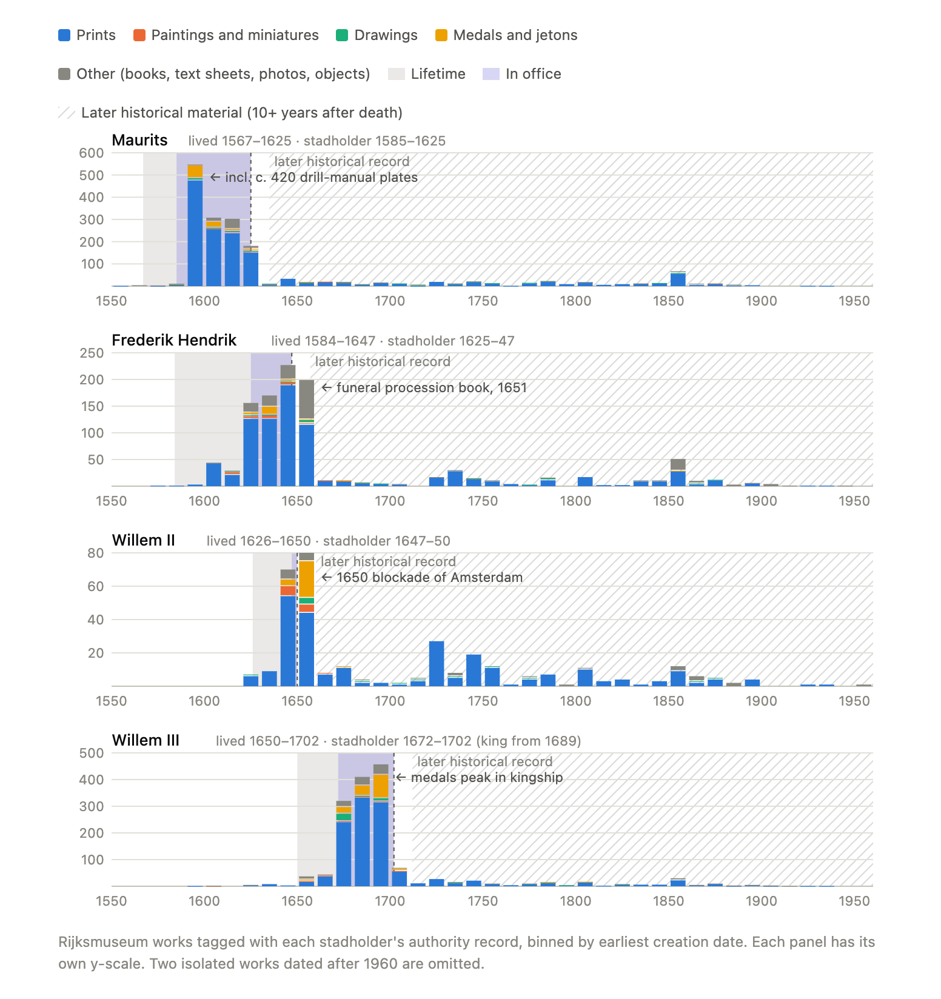
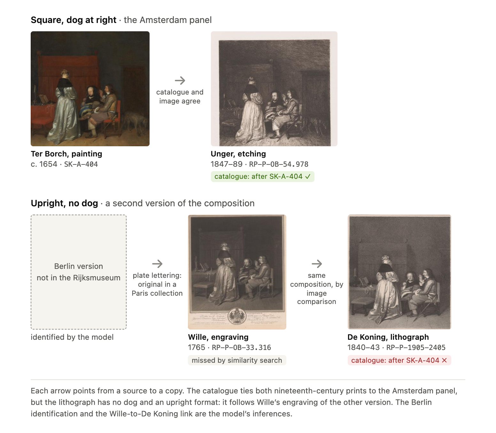
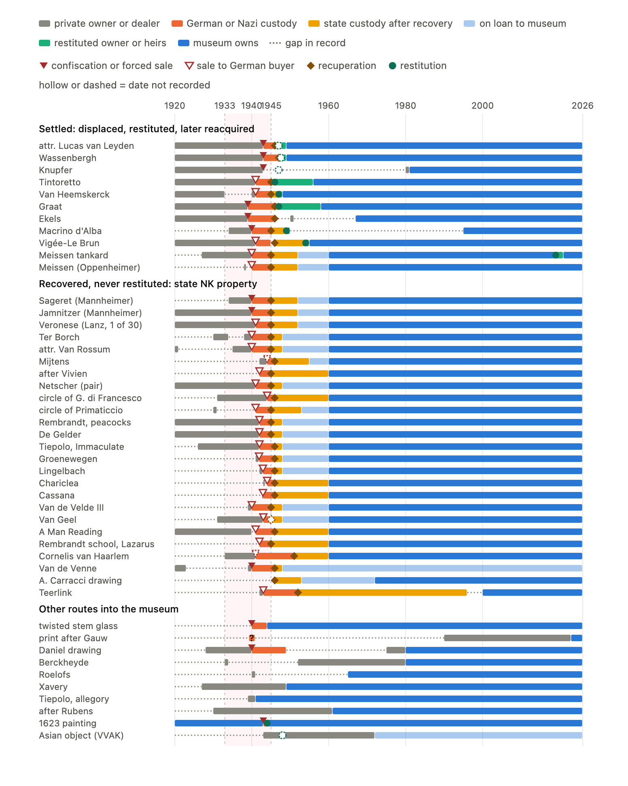

## Research Scenarios

The eight scenarios below are written for art historians, curators and other GLAM professionals. Each poses a research question that cannot be answered by retrieving records alone: the model has to check its results against the catalogue, weigh conflicting evidence and say how far its conclusions can be trusted. Together they cover the server's main areas (structured and semantic search, aggregate statistics, image inspection, similarity search, provenance, inscriptions and collectors' marks, bibliography, and conservation records), with an emphasis on questions that the Rijksmuseum's own search interfaces and data dumps do not support directly.

Each scenario has a question, and the **Demo** link opens the shared claude.ai transcript of the run (Claude Opus 5.5, medium effort, with the `rijksmuseum-mcp-plus` skill invoked at the start of the question). Scenarios 1 and 6 also include a follow-up prompt that asks for a chart and a short reading of it; shared transcripts do not show interactive charts, so a static image of each chart is included below its follow-up. The figure for scenario 3 was drawn afterwards from the demo's findings. Where a run produced HTML pages on the server (similarity comparisons, provenance enrichment reviews), saved copies are linked.

For a command-line version of scenario 7 that processes every stamped sheet, see the [CLI guide](cli-guide.md#worked-example-wallers-collectors-mark).

1. [Representations of the Stadholders, Maurits to William III](#1-representations-of-the-stadholders-maurits-to-william-iii)
2. [European–Asian Cultural Contact as Subject Matter](#2-europeanasian-cultural-contact-as-subject-matter)
3. [Prints after Gerard ter Borch's "Gallant Conversation"](#3-prints-after-gerard-ter-borchs-gallant-conversation)
4. [Dating Utamaro Prints from Their Seals and Signatures](#4-dating-utamaro-prints-from-their-seals-and-signatures)
5. [The Attribution of "The Tree of Jesse" (SK-A-3901)](#5-the-attribution-of-the-tree-of-jesse-sk-a-3901)
6. [Artworks Displaced between 1933 and 1945](#6-artworks-displaced-between-1933-and-1945)
7. [F.G. Waller's Collector's Mark (Lugt 2760)](#7-fg-wallers-collectors-mark-lugt-2760)
8. [The Rijksmuseum's Share of the 1936 Exhibition of Asian Art](#8-the-rijksmuseums-share-of-the-1936-exhibition-of-asian-art)

---

### 1. Representations of the Stadholders, Maurits to William III

*How were the successive stadholders, from Maurits to William III, represented across media in the collection, and does the evidence show changes in how their image was used? Check that each set of results actually refers to the stadholder in question, and distinguish works made during each man's lifetime from those produced later as historical record.* [Demo](https://claude.ai/share/f16d2bf1-bb11-45db-b5ac-b160d18d6b22)

**Follow-up:** *Draw small multiples, one panel per stadholder, showing the number of works per decade by medium, with each man's lifetime and period of office shaded and later historical material marked. Follow the chart with a short reading of what it shows.*

Static image of the interactive chart from the demo.

**Findings:** Prints dominate in every decade for all four men. Medals change role: for Maurits they are mostly jetons issued by the States General to celebrate his campaigns, while for William III they become a major medium, peaking in the 1690s, his years as king. William II, who held office for three years, is represented more by later material than by works made in his lifetime. Two decade peaks come from single projects (de Gheyn's drill manual in the 1590s, which depicts soldiers rather than Maurits, and the 1651 funeral-procession book for Frederik Hendrik), and the small counts before a sitter's birth are artefacts of broad date ranges rather than early portraits.

**How the tools enable it:**
- `collection_stats` with `depictedPerson` and `dimension: "type"` or `"decade"` gives per-medium and per-decade counts without paging through results
- exact depicted-person labels separate each stadholder from namesakes such as King William III of the Netherlands
- `search_artwork` and `get_artwork_details` on the works behind each peak identify what produced it

**Why it matters:** Counting depictions is simple; deciding which counts reflect use of the image during a reign, and which reflect a single publication or a cataloguing convention, is the historian's task. The aggregate tools make the first step quick enough to leave time for the second.

---

### 2. European–Asian Cultural Contact as Subject Matter

*Which works in the collection take contact between European and Asian cultures as their subject, as distinct from works that were simply made in Asia or depict it? Judge from the catalogue text whether each result is relevant, and identify which of the relevant works a search by production or depicted place would not find.* [Demo](https://claude.ai/share/a5563b64-5654-44f9-a5bb-7dd55a7dc346)

**Findings:** The model judged 29 works relevant. Of these, 23 are also found through a depicted place, and they cluster between the 1640s and the 1860s, when catalogue records reliably name a port, court or colony such as Batavia, Canton, Kandy or Nagasaki. The five works reached only through the catalogue text lie mostly outside that period or name peoples rather than places: an allegorical harpsichord lid of 1605, a print of 1675 showing Europeans martyred by Chinese, a banquet print of 1861, a cup of 1918 and a photograph of around 1990 showing André van der Louw with Deng Xiaoping. One further object is reachable only through its production place.

**How the tools enable it:**
- `semantic_search` and `search_artwork` with `textQuery` find works by what the catalogue text says they are about
- `search_artwork` with `depictedPlace` (and `expandPlaceHierarchy`) gives the place-based result set to compare against

**Why it matters:** Place fields record where a work was made or what it shows, not what it is about. Comparing the two routes shows which kinds of material (allegory, labels for peoples, modern diplomacy) a place-based search consistently misses.

---

### 3. Prints after Gerard ter Borch's "Gallant Conversation"

*Gerard ter Borch's "Gallant Conversation" (SK-A-404) was widely reproduced. Use the similarity search to identify related prints in the collection. Which of them reproduce this painting, which derive from another version or source, and which are related only in subject or style? Where the evidence conflicts, compare the images and explain your conclusion.* [Demo](https://claude.ai/share/a221b3f1-4ed3-4a80-b751-ed643b356efc) · [Similarity page](https://kintopp.github.io/rijksmuseum-mcp-plus/similar-to-SK-A-404.html)

Drawn from the demo's findings; not produced in the demo.

**Findings:** Unger's etching reproduces the Amsterdam panel, and here the catalogue and the image agree. The catalogue also links De Koning's lithograph (RP-P-1905-2405) to SK-A-404 and describes a dog that does not appear in the print. The lithograph instead follows the upright composition without a dog that Johann Georg Wille engraved in 1765, whose lettering places the painting he copied in a Paris collection. The model identifies that painting as the Berlin version and Wille's engraving as the lithograph's likely source, and marks both steps as its own inference. The similarity search found the Unger and De Koning prints but neither impression of Wille's engraving.

**How the tools enable it:**
- `find_similar` combines visual, iconographic, lineage and description signals and produces a comparison page
- `get_artwork_details` supplies the catalogue's own links and descriptions
- `inspect_artwork_image` lets the model compare compositions and read the lettering on the prints

**Why it matters:** Reproductive prints are often catalogued against the best-known version of a composition. Checking the catalogue link against the image can reveal a different source, and the similarity search alone would have missed half of the relevant prints.

---

### 4. Dating Utamaro Prints from Their Seals and Signatures

*The catalogue has not transcribed the Japanese text on these Utamaro prints: RP-P-1956-602, RP-P-1956-605, RP-P-1956-599, RP-P-1956-596, RP-P-1956-606, RP-P-1969-8, RP-P-1962-130 and AK-MAK-1161. Read the signatures, series titles, and publishers' and censors' seals, propose a date range for each print on that basis, and note where your dating differs from the catalogue and how certain it is.* [Demo](https://claude.ai/share/9a73b509-1ed3-4db0-a33f-7056fe7780a4)

**Findings:** For most prints the derived range agrees with the catalogue in period but is narrower; the catalogue tends to assign five-year blocks. Two prints move a year or so earlier on the evidence of series and printing state. RP-P-1956-596 is the one real disagreement: the model dates it as late as c. 1805 by association with Utamaro's courtesan series of the Kyōwa era. The catalogue range for RP-P-1956-606 runs to 1956, the year of acquisition, which is a cataloguing error. The model notes that the censors' seals add little (the *kiwame* seal only excludes dates before 1791); the narrower ranges come from publishers' marks, series titles and signature forms.

**How the tools enable it:**
- `inspect_artwork_image` returns full views and high-resolution crops of signatures and seals for the model to read
- `get_artwork_details` supplies the catalogue's date ranges and descriptions for comparison

**Why it matters:** Untranscribed text in a non-Latin script is invisible to every metadata search. Reading it from the image turns it into dating evidence, and the comparison with the catalogue shows where the record could be refined.

---

### 5. The Attribution of "The Tree of Jesse" (SK-A-3901)

*"The Tree of Jesse" (SK-A-3901) was bought in 1956 as a work by Geertgen tot Sint Jans and is now catalogued as circle of Geertgen. Review its technical examinations, conservation treatments and provenance together. What does each type of evidence establish, where do they agree or conflict, and how secure is the current attribution?* [Demo](https://claude.ai/share/0a1a7698-929f-48c9-ac5d-96245e940692) · [Enrichment review](https://kintopp.github.io/rijksmuseum-mcp-plus/enrichment-review-SK-A-3901.html)

**Findings:** Every change of attribution before the present one (Massys, Geertgen, Mostaert and back) predates the dendrochronological analyses of 1987 and 1995, so those changes rested on connoisseurship and the market. The tree-ring dating places the panel's likely use mostly after Geertgen's estimated death, which is the main reason the museum stopped short of naming him. The earliest proposed provenance, a link to the Haarlem convent of the White Ladies, depends on the figure of a nun that was hidden under overpaint until the 1932 treatment, so it is not independent evidence. Between the inventories of 1572–73 and an owner in Russia around 1850 there is no record of ownership.

**How the tools enable it:**
- `get_conservation_history` returns examinations (X-radiography, dendrochronology, infrared reflectography, paint samples) and treatments with dates and names
- `search_provenance` returns the parsed ownership chain
- `get_artwork_bibliography` gives the literature behind each attribution

**Why it matters:** Attribution arguments draw on technical, documentary and stylistic evidence that is usually kept in separate files. Bringing it together shows which conclusions depend on which evidence, and where one type of evidence has been read in the light of another.

---

### 6. Artworks Displaced between 1933 and 1945

*Which works in the collection were displaced between 1933 and 1945, and by what route did they enter the museum? For each, assess whether the wartime transfer was forced, whether the record supports a claim for restitution, and where the documentation is insufficient to decide.* [Demo](https://claude.ai/share/653b8433-81dd-4fd0-a608-dee11aba9a8a) · Enrichment reviews: [displaced works 1933–1950](https://kintopp.github.io/rijksmuseum-mcp-plus/enrichment-review-displaced-1933-1950.html), [Goudstikker 1938–1960](https://kintopp.github.io/rijksmuseum-mcp-plus/enrichment-review-goudstikker-1938-1960.html), [BK-17139](https://kintopp.github.io/rijksmuseum-mcp-plus/enrichment-review-BK-17139.html), [BK-17040-A](https://kintopp.github.io/rijksmuseum-mcp-plus/enrichment-review-BK-17040-A-2026.html), [RP-T-1980-26](https://kintopp.github.io/rijksmuseum-mcp-plus/enrichment-review-RP-T-1980-26-2026.html), [RP-P-2023-55](https://kintopp.github.io/rijksmuseum-mcp-plus/enrichment-review-RP-P-2023-55-2026.html), [SK-C-1343](https://kintopp.github.io/rijksmuseum-mcp-plus/enrichment-review-SK-C-1343.html), [SK-A-4130](https://kintopp.github.io/rijksmuseum-mcp-plus/enrichment-review-SK-A-4130.html), [SK-A-3437](https://kintopp.github.io/rijksmuseum-mcp-plus/enrichment-review-SK-A-3437.html)

**Note:** Expect this question to take much longer than the others (the demo run took about 20 minutes before the follow-up). Because it asks for an assessment of *each* displaced work, the model has to read the full ownership chain of every work with a recuperation event, some 850 in all. The provenance search returns at most 50 works per call, so this means paging through the whole set (in the demo, delegated to a sub-agent) before any assessment can begin.

**Follow-up:** *Draw a timeline from 1920 to the present with one row per work, showing periods of ownership, the events of confiscation, recuperation and restitution, and gaps in the record. Follow the chart with a short reading of what it shows.*

Static image of the interactive chart from the demo.

**Findings:** The parsed provenance records 853 works recuperated after the war, almost all through the Stichting Nederlandsch Kunstbezit (SNK); 791 of them belong to the Mannheimer collection, bought en bloc for the planned Linz museum in 1940. The model sorts the cases into three groups. Works returned to their owners after the war and later bought or given to the museum (for example SK-A-3902, SK-A-3739 and the Oppenheimer objects restituted in 2019) are settled. Works recuperated and never restituted are mostly Mannheimer objects, where the record names earlier owners such as Gutmann or Heilbronner but rarely says when Mannheimer acquired them, and some twenty purchases for Linz or Göring in the occupied Netherlands whose sellers are not identified; for these the documentation is insufficient. Among works that entered by other routes, the model identifies a glass confiscated from the Von Marx-May collection in 1940 and bought by the museum in 1944 (BK-15594) as the strongest open case. It also corrects two automated readings: an export-release stamp on RP-P-2023-55 parsed as a confiscation, and a collateral forfeiture parsed as a restitution. The timeline shows that gaps in the record for never-restituted works usually fall just before the wartime sale, where the owner's persecution status would have to be established, and that the transfer of these works to the museum in 1960 was a single administrative act rather than a decision about each work.

**How the tools enable it:**
- `collection_stats` with `dimension: "transferType"` and a provenance date range gives the overall pattern of transfers in the period
- `search_provenance` with `transferType` (confiscation, recuperation, restitution), `party` and a date range returns the parsed ownership chains, including gaps in the record
- where a structured event was produced with LLM assistance, the result links to a review page that shows the source text beside the interpretation

**Why it matters:** Provenance research for 1933–1945 is an ethical and legal obligation for museums, and it depends on reading ownership chains in full rather than matching keywords. The provenance data used here comes from an [experimental parser](https://kintopp.github.io/rijksmuseum-mcp-plus/provenance-parser-visualization.html) of the museum's provenance texts, aligned with [CMOA and PLOD conventions](https://kintopp.github.io/rijksmuseum-mcp-plus/provenance-patterns.html); its results should be checked against the source text before they are relied on.

---

### 7. F.G. Waller's Collector's Mark (Lugt 2760)

*The collector's mark of F.G. Waller (Lugt 2760) appears on tens of thousands of sheets in the Rijksprentenkabinet. Does it identify his personal collection? Use the available evidence, such as dates, credit lines and inventory numbers, to establish what the mark signifies, and state how far a conclusion based on a sample can be relied on.* [Demo](https://claude.ai/share/6401b054-25ae-4da1-84d9-17c442677c35)

**Findings:** The mark appears on some 33,600 records. Production dates are a weak test of Waller's ownership, since most stamped sheets were made in the eighteenth and nineteenth centuries and could have been his or bought later by the Waller Fund. Entry dates are a better test: in the model's sample of 25 sheets, every gift or bequest from Waller entered by 1935, 17 sheets entered after his death, and four were both made and acquired after 1934, so the stamp cannot mean that he owned them. The model notes that its sample was drawn from top-ranked search results and says nothing about proportions. The [CLI version](cli-guide.md#worked-example-wallers-collectors-mark) of this scenario tallies the credit lines of 20,000 stamped sheets and finds that about two-thirds were Waller Fund purchases.

**How the tools enable it:**
- `search_inscriptions` with `collectorMark` finds the sheets bearing the stamp, resolved through Lugt numbers
- `search_artwork` with an `inscription` filter and a date range gives counts by period
- `get_artwork_details` and `search_provenance` with `creditLineQuery` supply credit lines and acquisition dates

**Why it matters:** A collector's mark is often the only evidence of ownership for works on paper, but a museum may apply a collector's stamp to sheets bought with his fund as well as to those he owned. The scenario shows how to test what a mark records before using it to reconstruct a collection, and how much weight a sample can bear.

---

### 8. The Rijksmuseum's Share of the 1936 Exhibition of Asian Art

*The 1936 exhibition of Asian art from Dutch collections, held in Amsterdam, has no curated set in the Rijksmuseum. Reconstruct the museum's share of it from the bibliographic citations, then assess what that group of objects represents: who owned them in 1936, how they came to the museum, and what the reconstruction misses.* [Demo](https://claude.ai/share/1a4578fa-6bd1-4679-a79e-3ae57e568269) · Enrichment reviews: [1936 loans](https://kintopp.github.io/rijksmuseum-mcp-plus/enrichment-review-asian-art-loans-1936.html), [AK-MAK-224](https://kintopp.github.io/rijksmuseum-mcp-plus/enrichment-review-AK-MAK-224.html)

**Findings:** Citations of the 1936 catalogue identify 45 records, which correspond to 40 objects. Thirty-eight of them reached the Rijksmuseum by a single route, the long-term loan of the Royal Asian Art Society in the Netherlands in 1972, and 26 came to the society through the bequests of Betsy Westendorp-Osieck and Carolina Verburgt-Kramers in 1968. The two collections differ in kind: nearly all the Japanese objects came from Westendorp, while Verburgt-Kramers lent archaic Chinese bronzes, Chinese ceramics, and Indian and Javanese sculpture. The model points out that the 1936 owners are inferred from provenance chains rather than taken from the exhibition's list of lenders.

**How the tools enable it:**
- `find_artworks_citing_publication` gathers every object whose bibliography cites the 1936 catalogue
- `get_artwork_bibliography` gives the catalogue numbers and other citations
- `search_provenance` traces each object's owners from 1936 to its acquisition

**Why it matters:** Most past exhibitions are not recorded as sets in museum databases, but their catalogues are often cited in object bibliographies. Following those citations recovers an exhibition's content, and the provenance chains show what it represented at the time.
